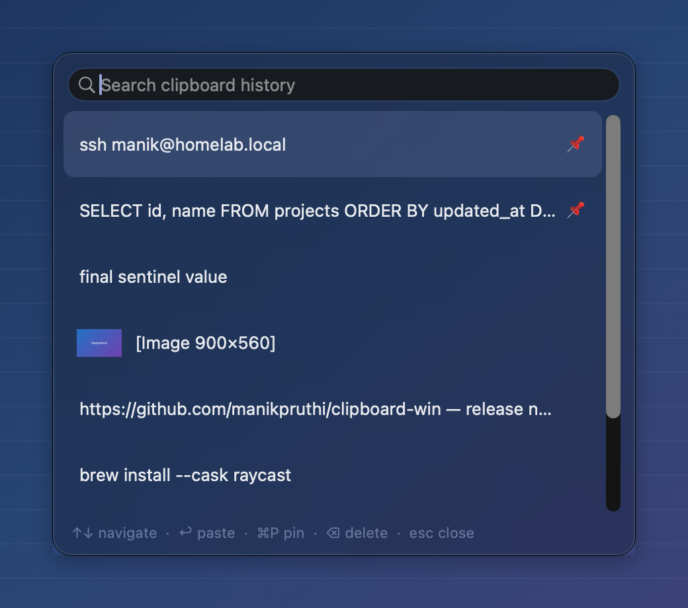
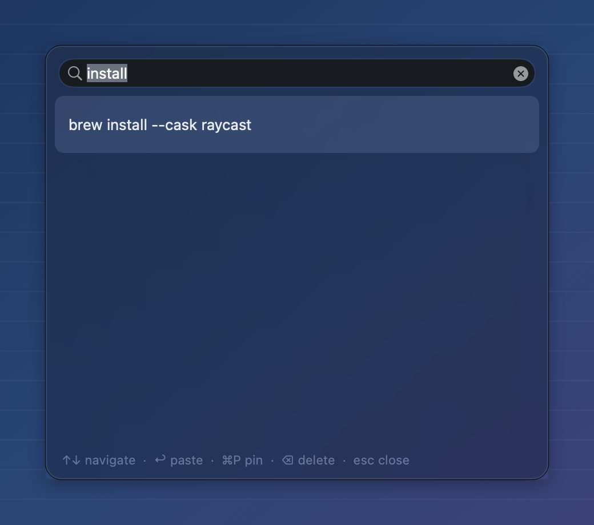

# Clipboard Win

Native macOS menu bar app that brings Windows 11-style clipboard history (`Win+V`) to the Mac. Press **Control+Shift+V** anywhere to open a searchable popup, then pick a text snippet or image to paste into the app you were using.



Pinned items stay at the top, image entries get thumbnails, and long text truncates cleanly.



## Features

- **Global hotkey** — `Control+Shift+V`, swallowed so it never types a stray `V` into your document; press it again to close the panel
- **Text and image history** with thumbnails, capped at 50 unpinned entries and 200 MB of unpinned data to keep memory low (single images over 25 MB are skipped)
- **Live search** — case-insensitive filtering as you type, across the full text
- **Password-safe** — skips anything a password manager marks as concealed or transient ([nspasteboard.org](http://nspasteboard.org) markers)
- **Formatting preserved** — every representation the source app provides (RTF, HTML, file URLs, custom app types) is stored and restored on paste, so bold text, links, spreadsheet cells and Finder files paste back exactly as copied
- **Text first** — when a copy carries both text and a rendered image (spreadsheet cells, rich text, Finder files), the text is kept; browser "Copy Image" still records the image
- **Pinning** — `⌘P` or the right-click menu keeps an entry at the top permanently
- **No duplicates** — re-copying the same content moves the existing entry to the top (keeping the newest formatting) instead of cloning it
- **Hover and selection feedback** with a native accent highlight
- **Menu bar only** — runs as an `LSUIElement`, no Dock icon
- **Universal binary** — Apple Silicon and Intel
- **Native AppKit** — no web views, no third-party dependencies

## Install

### Option 1: DMG (easiest)

1. Open `release/Clipboard-Win-1.1.0.dmg`
2. Drag **Clipboard Win.app** into `Applications`
3. Open it from Applications (right-click → **Open** the first time, since the build is ad-hoc signed)
4. Grant **Accessibility** and **Input Monitoring** access — see below

### Option 2: Build from source

```bash
./build.sh release
cp -R "$HOME/Library/Caches/ClipboardWinBuild/Clipboard Win.app" /Applications/
open "/Applications/Clipboard Win.app"
```

### Option 3: Build and package a DMG

```bash
./package.sh          # builds universal app, writes release/Clipboard-Win-<version>.dmg
```

## Permissions

Clipboard Win installs a session-wide keyboard event tap to catch (and swallow) `Control+Shift+V`, and posts a synthetic `⌘V` when you pick an item. On current macOS this needs two permissions:

- **Accessibility** — to swallow the hotkey and to post the synthetic paste
- **Input Monitoring** — to receive keyboard events at all

1. On first launch the app shows the macOS prompts for whichever is missing. You can also use the menu bar clipboard icon → **Grant … Access…**, which opens the right Settings pane.
2. Enable **Clipboard Win** under **System Settings → Privacy & Security → Accessibility** and **→ Input Monitoring**.
3. No relaunch needed — the app retries every 3 seconds and starts the hotkey as soon as both are granted. The menu item then reads **Permissions Granted ✓**.

`build.sh` pins the ad-hoc code signature's designated requirement to the bundle identifier, so these grants survive rebuilds. Older builds were signed against their exact binary: if the hotkey does nothing after updating, remove **Clipboard Win** from both lists with **−** and add it again.

To check the hotkey's state, run `log show --info --last 5m --predicate 'subsystem == "com.manikpruthi.clipboardwin"'`.

## Usage

| Action | Shortcut |
|---|---|
| Open / close history | `Control+Shift+V` |
| Move selection | `↑` / `↓` |
| Paste selected item | `Return` or click |
| Pin / unpin selected item | `⌘P` (or right-click) |
| Delete selected item | `⌘Delete`, or `Delete` when the search field is empty (or right-click) |
| Dismiss and return to the previous app | `Esc` (or click away) |

The panel opens on whichever display your pointer is on, and dismisses as soon as another app takes focus. The menu bar icon also offers **Clear Unpinned** and **Quit**.

Pasting needs Accessibility. Without it the item is still placed on the clipboard and focus returns to your app, so you can press `⌘V` yourself.

## How it works

- `HistoryService` polls `NSPasteboard.general.changeCount` every 250 ms, dedupes by a SHA-256 of the content, and keeps pinned entries above unpinned ones.
- `ClipboardItem` snapshots every concrete pasteboard representation for faithful re-pasting, stores images as PNG (converting TIFF with ImageIO), records their real pixel size, and pre-renders a 96 px thumbnail once so the list never decodes full images while scrolling.
- `HotkeyService` creates a `CGEvent` tap, ignores key auto-repeat, re-enables itself when macOS disables the tap on timeout, and retries every few seconds until the tap can be created.
- `main.swift` sets `NSAutoFillHeuristicsEnabled` to false for this app, so focusing the search field doesn't spawn an extra "AutoFill (Clipboard Win)" helper process.
- `ClipboardPanel` is a borderless `NSPanel` with vibrancy, reusable row and cell views, and a local key monitor for navigation.

Pasting writes the stored snapshot back to the pasteboard (falling back to plain text, or PNG with TIFF created on demand), reactivates the previous frontmost app, then posts a synthetic `⌘V` — so history itself never pollutes the history.

### Known limitations

- History lives in memory only and is cleared when the app quits.
- A copy whose representations add up to more than 25 MB is kept as plain text or PNG only, without formatting.
- File promises and system-synthesized (`dyn.*`) types aren't captured, so apps that copy only via file promises may paste plain content.
- The hotkey and the synthetic paste use the physical `V` key position (ANSI keycode 9), so on non-QWERTY layouts such as Dvorak the keys differ.

## Requirements

- macOS 14 or later
- Xcode Command Line Tools (`xcode-select --install`) to build; Xcode 16+ also works
- `package.sh` creates the DMG with `diskutil image create`, which needs a recent macOS that ships `diskutil image`
- Ad-hoc signed (not notarized), so the first launch needs right-click → **Open**

## Project layout

```
clipboard/
├── Sources/
│   ├── App/         AppDelegate (status item, permissions), main.swift
│   ├── Models/      ClipboardItem — pasteboard capture and paste
│   ├── Services/    HistoryService, HotkeyService
│   └── UI/          ClipboardPanel — popup, rows, search, keyboard
├── Resources/       Info.plist
├── docs/screenshots/
├── release/         prebuilt DMG
├── build.sh         builds a universal .app into ~/Library/Caches/ClipboardWinBuild
├── package.sh       builds + wraps it in a DMG under release/
└── LICENSE
```

## License

MIT — see [LICENSE](LICENSE).
